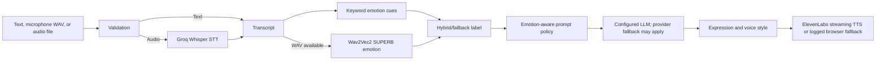

# Project Audit

Audit date: 2026-10-15. Project root: `D:\sova\WEINGS_AI_SOVA_PAPER_MODELS_ONLY (1)\WEINGS_AI_SOVA_PAPER_MODELS_ONLY`.

## Application layout

- Backend: FastAPI application `app.main:app`; lifecycle setup is in `app/core/lifecycle.py`.
- API composition: `app/api/router.py` mounts `app/api/v1/router.py` under `/api/v1`. The supplied checkout mounted routes under `/v1` only, making documented `/api/v1/...` URLs return 404. Router composition is corrected in this project.
- Voice endpoints: `app/api/v1/voice.py`; local demo and development token: `app/api/v1/demo.py`; single-page frontend: `app/api/v1/demo.html`.
- FastAPI serves the frontend. There is no separate frontend build or frontend server.
- Voice composition: `app/services/speech/service.py` connects Groq Whisper STT, the companion runtime, emotion detection, and ElevenLabs TTS.

## Environment and dependencies

- Python: 3.13.4; project constraint: `>=3.11,<3.14`.
- The existing Windows environment is `.venv`. `pip check` reported no broken requirements.
- Dependencies are described in `pyproject.toml` and pinned in `uv.lock`. The `dev` extra includes pytest and HTTP test dependencies.
- This checkout has no Git metadata, so there is no commit or branch to identify its source state. Changed files were backed up under `results/prechange_backup/`.
- Use the existing `.venv` and `.env` beside the source. Do not copy `.env` into reports or share it.

## Configured providers

Safe settings inspection and live requests confirmed:

- LLM: Groq, model `openai/gpt-oss-120b`.
- STT: Groq Whisper `whisper-large-v3-turbo`.
- TTS: ElevenLabs with the configured voice and model.
- Provider credentials are configured locally; actual Groq and ElevenLabs calls succeeded on 2026-10-15. Credential values are intentionally omitted.
- Local acoustic emotion model: `superb/wav2vec2-base-superb-er`, loaded lazily. The detector expects WAV PCM and resamples to 16 kHz. Its confidence is a model softmax score, not a calibrated probability or measured accuracy.
- Text-only emotion detection is a keyword rule and is labelled `text_proxy_fallback`; it is not an acoustic classification.

## Pipeline and behavior

- Acoustic classes map to angry, happy, sad, and neutral. The lexical rule set also recognizes anxious and frustrated. The final label, confidence, source, and available top acoustic labels are returned.
- Fusion rules in `app/engines/emotion/hybrid.py`: strong lexical signal can override neutral acoustics; agreeing predictions add a small capped confidence increment; otherwise a confident acoustic prediction wins; weak or unavailable acoustics use the text proxy.
- `app/runtime/nodes/prompt_builder.py` inserts the detected emotion and a short response policy into the prompt. It does not expose hidden model reasoning.
- Actual LLM provider/model metadata now propagates to text responses and audio headers. `processing_ms` is server-measured runtime time; for audio, the browser also measures from request submission through playback completion.
- Sessions live in the process-local `VoiceSessionRegistry`; JWT ownership checks protect them, but they are not persisted across server restarts.
- Audio barge-in uses browser VAD, stops playback, aborts the request, and calls session cancellation. The streaming route registers its active task. Browser mic permission and physical interruption still need a manual check.

## Routes

- `GET /api/v1/health/live`: process liveness; no database check.
- `GET /api/v1/health/ready`: dependency readiness; may return 503 when PostgreSQL or Redis is unavailable.
- `GET /api/v1/demo`: development-only demo page.
- `GET /api/v1/demo/token`: short-lived development token; intentionally 404 in production.
- `GET /api/v1/demo/diagnostics`: provider/model readiness without credentials.
- Voice endpoints: session creation, text turn, audio stream turn, cancellation, metrics, emotion status/warmup, transcription, and synthesis in `app/api/v1/voice.py`.
- `GET /docs` and `GET /openapi.json`: Swagger and OpenAPI.

Audio uploads are capped at 10 MiB by the API. The UI accepts WAV, MP3, OGG, and WebM up to three minutes and rejects empty, oversized, undecodable, or overlong files. STT supports those four types. Acoustic SER accepts WAV input; compressed audio correctly reports the text-proxy fallback.

## Baseline and validation evidence

- Initial default pytest collection hit seven duplicate-module import errors because the supplied tree contains stale bytecode and repeated test basenames. `--import-mode=importlib` avoids deleting those files and is now the pytest default.
- Baseline full suite with importlib: 652 passed, 56 failed, 22 errors. Failures included old API-prefix assumptions, provider tests whose global settings were overridden by this `.env`, and unrelated memory/personality/cache/vector-store defects. The final full-suite result is saved in `results/final_pytest.log`.
- Focused API, voice, emotion, prompt, LLM, and benchmark checks are saved in `results/focused_pytest.log`.
- Static checks: `python -m compileall -q app tests` and Node syntax check of the demo script. Live checks are in `results/live_e2e_smoke.md`.
- Unit tests do not prove browser microphone permission, physical barge-in, or model classification accuracy.

## Benchmark audit

The benchmark code, paper references, historical runs, and limitations are described in `docs/SOVA_BENCH_AUDIT.md`, `benchmark/README.md`, and `benchmark/RESULTS_AND_CALCULATIONS_GUIDE.md`. Existing outputs contain partial runs with different datasets and protocols; do not pool them into one Table 4 result. No official SOVA open-model checkpoint or bridge environment is configured here. The Weings generation pilot uses Groq GPT-OSS, not one of the paper's open speech-model baselines.

Exact formulas and output paths are in `docs/METRICS_AND_FORMULAS.md`; viva explanations are in `docs/VIVA_PREPARATION.md`.
